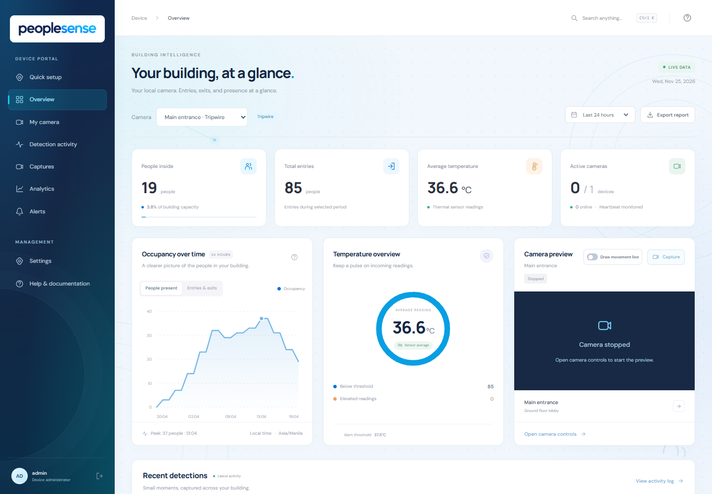

<div align="center">
  
  <h1>PeopleSense</h1>
  <p><strong>A Raspberry Pi camera portal for counting people and monitoring a room locally.</strong></p>
  <p>Entry and exit counts · Live occupancy · Person-triggered captures · Pan and tilt</p>
  <p>
    
    
    
    <a href="LICENSE"></a>
  </p>
  <p><a href="#overview">Overview</a> · <a href="#features">Features</a> · <a href="#quick-start">Quick start</a> · <a href="#camera-modes">Camera modes</a> · <a href="#development">Development</a></p>
</div>



<p align="center"><em>The PeopleSense Overview with sample detections.</em></p>

## Overview

PeopleSense turns a Raspberry Pi 4 and one USB webcam into a local monitoring appliance. Use the browser portal to draw a counting line across a doorway, track entries and exits, or monitor how many people are visible in an area. The Pi processes video locally and stores events and captures on the device.

The Pi hosts its own Wi-Fi access point, so a phone or computer can open the portal without an internet connection after installation. The portal also runs on Windows for development and USB camera testing.

## Features

| Area | What you can do |
| --- | --- |
| Tripwire | Draw a doorway line, set the IN direction, and count confirmed crossings in both directions. |
| Surveillance | View the current number of people and their estimated stay time in the camera’s field of view. |
| Captures | Save a photo manually from the live preview or collect person-triggered photos at a set interval in Surveillance. |
| Activity and reports | Review detection history, filter by reporting period, and export a CSV. |
| Live preview | Choose a 30 or 60 FPS preview target and review the measured preview and detection rates. |
| Person detection | Use the default EfficientDet-Lite0 model or select YOLOX-Nano as a lower-resource option. |
| Raspberry Pi hardware | Use optional GPIO servos to pan and tilt the camera and a DHT11 to read ambient temperature and humidity. |
| Device setup | Configure the administrator password, Wi-Fi hotspot, USB camera, and reporting time zone. |

## Quick start

### Raspberry Pi 4

Use 64-bit Raspberry Pi OS Trixie or Bookworm and plug in a USB webcam. Keep the Pi online for the initial package and model downloads. Run setup from the Pi’s local terminal or over Ethernet because the hotspot takes over its Wi-Fi interface.

1. [Download `setup_peoplesense.py`](https://raw.githubusercontent.com/maeven-tapa/peoplesense/main/setup_peoplesense.py) and run it from the download folder.

   ```bash
   python3 setup_peoplesense.py
   ```

2. Start PeopleSense after installation.

   ```bash
   cd /opt/peoplesense
   python3 main.py
   ```

3. Join **PeopleSense-AP** and open [the device portal](http://10.0.0.1/). On a fresh install, sign in as `admin` with `12345678`, then set a new password in Quick setup.
4. Choose the USB camera and a camera mode. For Tripwire, save the counting line and confirm the IN direction. Open **My camera** and select **Start camera**.

Keep the terminal open while the app runs. Press **Ctrl+C** to stop it and rerun `main.py` after a reboot. The Pi guide covers wiring, services, updates, repairs, and logs. [Raspberry Pi installation guide](deploy/rpi/README.md)

### Windows

Use PowerShell and Python 3.11. The USB camera and detection modes run locally on Windows. Hotspot broadcasting and GPIO controls require the Pi.

```powershell
git clone https://github.com/maeven-tapa/peoplesense.git
cd peoplesense
py -3.11 -m venv .venv
.\.venv\Scripts\python.exe -m pip install -r requirements.txt
.\.venv\Scripts\python.exe manage.py download_models
.\start.ps1
```

Open [the local portal](http://127.0.0.1:8000/) and use the first-run credentials above if the database is new. The start script applies migrations and initializes the appliance before starting Django.

## Camera modes

| Mode | What gets recorded |
| --- | --- |
| Tripwire | An Entry or Exit when a tracked person crosses the saved line. Occupancy is entries minus exits, with a minimum of zero. |
| Surveillance | The visible person count and time spent in view. It saves a photo when a person appears, then at the configured interval while people remain visible. |

Switch modes under **My camera → Camera mode & controls**, then start the camera. Use **Capture** in either mode to save the current frame. The portal stores JPEGs on the device and requires administrator sign-in to view them. Tracking is anonymous and uses no face recognition.

For line placement, camera movement, preview settings, and privacy and storage details, see the [device portal guide](docs/device-portal.md).

## Project structure

```text
peoplesense/
├── assets/                 # README screenshot
├── deploy/rpi/             # Pi installer builder, Nginx, and systemd services
├── docs/                   # Device portal guide
├── hardware/               # Pan/tilt and ambient sensor worker
├── networking/             # Wi-Fi access point worker
├── peoplesense/            # Django settings and root URLs
├── portal/                 # Views, models, forms, and migrations
├── static/                 # Branding, CSS, and browser scripts
├── templates/              # Portal pages and components
├── vision/                 # Camera capture, inference, and tracking
├── main.py                 # Starts and stops the installed Pi appliance
├── manage.py               # Django command entry point
├── requirements.txt
└── setup_peoplesense.py    # Self-contained Raspberry Pi installer
```

## Development

Run these commands from the repository root with the project environment active.

```sh
python manage.py check
python manage.py test
python manage.py makemigrations --check --dry-run
python -m unittest discover -s deploy/rpi -p "test_*.py"
```

When changing files bundled into the Pi installer, rebuild it with `python deploy/rpi/build_installer.py`. Use the [device portal guide](docs/device-portal.md#verification-and-deployment) for vision smoke checks and the [Pi guide](deploy/rpi/README.md) for on-device verification.

## License

PeopleSense is licensed under the [Apache License 2.0](LICENSE).
